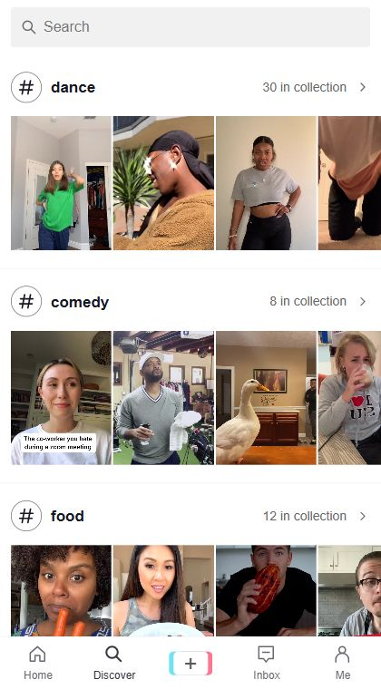
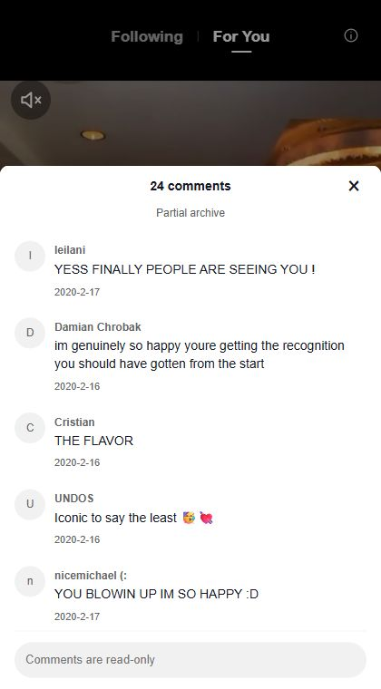

# TikTok 2020

**Renegade. Savage. Just 1 more video.**

A little time machine for the FYP you remember, or the one you missed.

**[Start scrolling](https://foo-rq.github.io/tiktok-2020/)**

<p>
  
  
  
</p>

## Got 145 minutes?

**541 videos. 2 hours and 25 minutes back on your FYP.**

The Renegade you never quite learnt. The sound you still know by heart.

<details>
<summary>Where that number comes from</summary>

A [CHI 2024 study](https://homes.cs.washington.edu/~franzi/pdf/zannettou-tiktok-chi24.pdf) of 347 TikTok users reports first-day averages of 107.31 videos and 1,730 seconds of viewing, in section 5.1.

```text
107.31 ÷ (1,730 ÷ 60) ≈ 3.72 videos per minute
541 ÷ 3.72 ≈ 145 minutes
```

The calculation uses a ratio of the study’s group averages and 1 visit per video. It is not a measurement of this app or of TikTok in 2020. Replays, loading and time spent in comments change the total.

</details>

## The songs come back pretty quickly

Renegade, Savage, Say So, Tap In, Supalonely and Bored in the House are in the collection. So are the memes, familiar creators and less famous videos that made an FYP feel like an FYP.

- **Keep scrolling.** Videos autoplay and loop. Tap to pause, or use the arrow keys on desktop.
- **Make it yours.** The feed mixes featured videos with your watch history and interests. Likes and follows help shape it when you're signed in.
- **Find the one you're thinking of.** Search creators, captions, hashtags or sounds. Recent searches stay on your device.
- **Read the room as it was.** 15,616 archived comments across 532 videos, all dated before January 1, 2021.

## See it move


[Watch playback and comments](https://foo-rq.github.io/tiktok-2020/docs/media/walkthrough.mp4) or [watch search and profiles](https://foo-rq.github.io/tiktok-2020/docs/media/search.mp4).

## Browse first. Sign up when you feel like it.

You can watch without an account. Sign up with email to save likes and follow creators across devices. Confirm your email, then log in. Device preferences are only imported when you choose to import them.

Light mode is the default. There's a desktop dark-mode toggle for late-night scrolling.

<details>
<summary>A few things to know</summary>

This is an independent reconstruction, not an official TikTok app. The interface follows period references, with some practical additions. The recommendation system is our own. [Design research and known differences](sources/fidelity-audit.md).

The collection is partial. 9 videos currently have no archived comments. Comments are read-only and aren't recreated when missing.

Playback depends on TikTok streams resolved through fxTikTok. Original video quality and availability vary. Videos keep their proportions, with black space where needed. Share includes a link to watch the original on TikTok.

Video creation and messaging are disabled. Videos, sounds and comments belong to their respective creators.

</details>

<details>
<summary>Run it locally</summary>

The app uses HTML, CSS and JavaScript, with Supabase for accounts and saved preferences. There's no build step.

```sh
python -m http.server 5188 --bind 127.0.0.1
```

Open [localhost:5188](http://127.0.0.1:5188/).

For your own deployment, configure a Supabase project using [account-schema.sql](account-schema.sql), then update [auth-config.js](auth-config.js). That browser key is intentionally public. Keep secret keys and email credentials out of the repository.

Run the checks with Node.js and Python. In PowerShell:

```powershell
Get-ChildItem check*.cjs | ForEach-Object {
  node $_.FullName
  if ($LASTEXITCODE -ne 0) { throw "Failed: $($_.Name)" }
}
python check-collector.py
```

The checks cover playback, feed selection, account state, comment paging, sharing, search history and data validation. They don't send emails or create accounts. The live email-confirmation and login flows were separately tested with disposable accounts.

</details>
